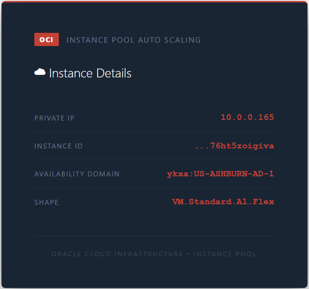

# OCI Instance Pool behind a Flexible Load Balancer

A minimal **OCI instance pool** built with Terraform. Apache web servers run
on private Ampere **VM.Standard.A1.Flex** instances behind a public
**flexible load balancer**, and each one serves a page with its own metadata
(private IP, instance OCID, availability domain and shape) from the OCI
instance metadata service. An **autoscaling configuration** sizes the pool
on CPU. There's no Packer and no custom image: one Terraform phase does it
all.



See it in action:

[](https://www.youtube.com/watch?v=FDhxa3M9RSk)

| Piece | Where | Role |
|---|---|---|
| **asg-lb** | public subnet (`10.0.0.0/26`) | public flexible load balancer, 10 to 100 Mbps; HTTP listener on 80 |
| **asg-backend-set** | `asg-lb` | round robin; HTTP health check on `/` every 10 seconds, expecting 200 |
| **asg-instance-config** | instance configuration | `VM.Standard.A1.Flex`, 1 OCPU, 4 GB; Oracle Linux 9; private subnet, no public IP; Terraform-generated SSH key; `userdata.sh` installs Apache, opens HTTP in firewalld and writes the metadata page and `/plain` (just the private IP) |
| **asg-pool** | private subnet (`10.0.0.128/26`) | 4 instances to start, placed across AD-1 and AD-2; registered with the backend set on port 80 |
| **asg-autoscaling** | autoscaling | threshold policy, 3 to 6 instances, 300-second cooldown; see [Scaling](#scaling) |
| **asg-bastion** | OCI Bastion | Standard bastion targeting the private subnet, client CIDR `0.0.0.0/0`; used by `connect.sh` |
| **Internet / NAT gateways** | VCN | the internet gateway for the public subnet, the NAT gateway for the private one |
| **Security lists** | VCN | public: 80 from anywhere; private: 80 from the public subnet, 22 from the VCN (for Bastion) |
| **VCN** | `us-ashburn-1` | `10.0.0.0/24` |

## Architecture

<picture>
  <source media="(prefers-color-scheme: dark)" srcset="architecture-dark.svg">
  
</picture>

Regenerate with `python3 make_diagram.py`.

- **`01-instance-pool/`**: `networking.tf`, `security.tf`, `lb.tf`,
  `instanceconfig.tf`, `instancepool.tf` (pool and autoscaling),
  `bastion.tf` and `scripts/userdata.sh`.
- **`connect.sh`**: SSH to an instance through the Bastion.
- **`debug.sh`**: prints backend health, backend set status, the pool's
  instances and the first instance's console history.

## Scaling

| Rule | Condition | Action |
|---|---|---|
| `asg-scale-out` | CPU > 60% | +1 instance |
| `asg-scale-in` | CPU < 1% | -1 instance |

The pool stays between 3 and 6 instances, and 300 seconds (OCI's minimum)
must pass between scaling actions. The pool ignores changes to its size in
Terraform, so a later `apply` doesn't undo what autoscaling did.

## Prerequisites

* [An OCI Account](https://cloud.oracle.com/)
* [Install OCI CLI](https://docs.oracle.com/en-us/iaas/Content/API/SDKDocs/cliinstall.htm), configured in `~/.oci/config`
* [Install Terraform](https://developer.hashicorp.com/terraform/install)

Set `OCI_COMPARTMENT_ID` to deploy into a compartment; otherwise the
scripts use the tenancy OCID from `~/.oci/config`.

## Deploy

```bash
git clone https://github.com/mamonaco1973/oci-instance-pool.git
cd oci-instance-pool
./apply.sh
```

`apply.sh` runs `check_env.sh`, applies `01-instance-pool` and runs
`validate.sh`, which waits for the load balancer to return HTTP 200 on
`/plain` and samples six responses:

```
NOTE: Load balancer endpoint: http://xxx.xxx.xxx.xxx
NOTE: Waiting for HTTP 200 from load balancer...
NOTE: Load balancer returned HTTP 200
NOTE: Sampling load balancer responses...

  [1] 10.0.0.132
  [2] 10.0.0.197
  [3] 10.0.0.132
  [4] 10.0.0.197
  [5] 10.0.0.132
  [6] 10.0.0.197

=================================================================================
  Instance Pool — Deployment validated!
=================================================================================
  LB  : http://xxx.xxx.xxx.xxx
=================================================================================
```

## Try it

1. Open the endpoint in a browser and refresh: the private IP, OCID and
   availability domain change from request to request.
2. SSH to an instance as `opc`:

   ```bash
   ./connect.sh               # the first running instance
   ./connect.sh 10.0.0.150    # or a specific private IP
   ```

   `connect.sh` creates a throwaway key pair, opens a Bastion
   port-forwarding session to port 22, tunnels it to `localhost:2222` and
   signs in with `01-instance-pool/keys/Private_Key`.
3. Load the CPU there (for example `stress-ng` or `yes > /dev/null`) and
   watch the pool grow, or run `./debug.sh` to see backend health.

## Teardown

```bash
./destroy.sh
```

## Notes

- **Lab only.** HTTP only, and the Bastion accepts sessions from any client
  CIDR.
- The old README described a minimum of 1 and a scale-in threshold of 60%;
  the configuration uses a minimum of 3 and scales in below 1% CPU. It also
  linked the AWS setup video under an OCI title, so that link is gone.
